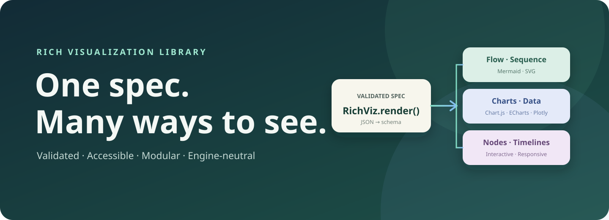
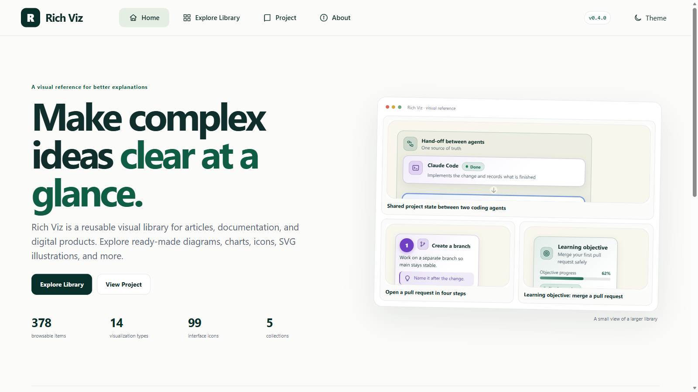
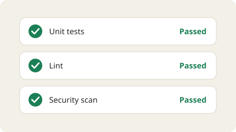
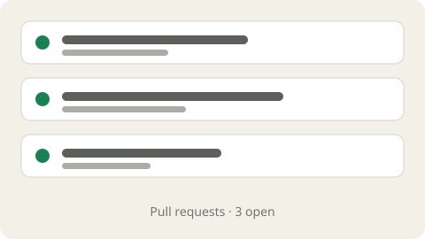

<div align="center">

# Rich Visualization Library
### Rich Viz

**One validated specification. Multiple rendering engines. Accessible visuals for every kind of article.**

[](VERSION) [](LICENSE) [](Examples/) [](docs/ARCHITECTURE.md)

Copyright © 2026 Abdulrahman ElBatrah. Original Rich Viz material is licensed under Apache License 2.0; bundled third-party components retain their own licenses.

[Home](visual-browser/index.html) · [Explore Library](visual-browser/library.html) · [Diagrams](visual-browser/diagrams.html) · [Project](visual-browser/project.html) · [About](visual-browser/about.html) · [Open the QA Gallery](src/gallery/index.html) · [Browse diagram docs](docs/diagrams/) · [Installation skill](skills/richviz-integration/SKILL.md) · [Updater skill](skills/richviz-updater/SKILL.md)

</div>





Rich Visualization Library (Rich Viz) is a general-purpose, schema-first JavaScript library for static and interactive visuals across article types, with strong support for educational writing. Authors keep each visualization as editable JSON; the library validates it, selects a focused renderer, and loads an optional engine only when needed. It runs in a browser without requiring a host CMS, a CDN, or a framework build step.

**Reader refinement:** Arabic subtitles wrap inside cards, group tags have reserved space, arrow tips meet their paths and instructional labels retain a 16px base. See the unified controls and connector contract below.

The Visual Browser exists to make the library’s contents easy to explore by sight. The Home page introduces the project and previews real examples; Explore Library opens a dashboard with dynamic counts, search and independent collection routes. Browse [Diagrams](visual-browser/diagrams.html), [Icons](visual-browser/icons.html), [Application Icons](visual-browser/app-icons.html), [SVG](visual-browser/svg.html), and [Stickers](visual-browser/stickers.html), then reuse an item by its stable reference ID and source path.

<div align="center">

| Workflow examples | Editorial examples |
|:--:|:--:|
|  |  |
| [Explore the library dashboard](visual-browser/library.html) | [Diagrams](visual-browser/diagrams.html) · [99 interface icons](visual-browser/icons.html) · [231 application icons](visual-browser/app-icons.html) · [SVG illustrations](visual-browser/svg.html) · [Stickers](visual-browser/stickers.html) |

</div>

> **License scope:** Apache-2.0 applies to original source, documentation, examples, and assets authored for this library by Abdulrahman ElBatrah. Separately licensed third-party software remains under its upstream license; see [`THIRD_PARTY_NOTICES.md`](THIRD_PARTY_NOTICES.md), preserved vendor files, and [`NOTICE`](NOTICE).

## What is included

- One renderer registry with lazy-loaded renderers and engine adapters.
- 14 registered visualization types, one media example, and 9 additional composition/data patterns (24 authored examples total).
- Six engine integrations: Mermaid, React Flow/XYFlow, Chart.js, Recharts, ECharts, and Plotly; native SVG provides a dependency-free chart baseline.
- A central diagram metadata registry and per-type documentation.
- Safe declarative JSON validation, controlled SVG and text rendering, accessible text alternatives, RTL, themes, and responsive layouts.
- Local, offline-capable vendor snapshots with upstream notices; no required CDN.
- Separate visual collections: 99 original interface glyphs; 231 unique Captiva application icons after resolving source aliases and removing all duplicate file hashes; 13 discovered SVG illustrations (two original developer concepts, ten new illustrations and the existing hero artwork); and 11 original developer stickers.
- Third-party Captiva application icons retain their GPL-3.0+ license and full source attribution, separate from Rich Viz original Apache-2.0 work; see [third-party notices](THIRD_PARTY_NOTICES.md).

## Browse Rich Viz locally

Run `Start Website.bat` on Windows, or run `python server.py` (Python 3.9 or newer) from this folder. The local server prints the browser URL and serves the Visual Reference Browser on loopback only. No packages or internet connection are required. See [Visual Browser](visual-browser/README.md).

## Quick start

Serve this folder over HTTP (ES modules do not work reliably from `file://`):

```sh
npm run gallery
```

Open the URL printed by the local server. To embed a visual, serve the repository at the same origin and import the runtime module:

```js
import { RichViz } from "./src/RichVisualization.js";
import { EXAMPLES } from "./src/RichVisualizationExamples.js";

const handle = RichViz.render("#diagram", EXAMPLES["step-guide"]);
handle.dispose();
```

See [API](docs/API.md), [Architecture](docs/ARCHITECTURE.md), and [Engine compatibility](docs/ENGINES.md).

## Diagram catalog

The [diagram registry](src/RichVisualizationRegistry.js) is the metadata authority used to generate the documentation index. The public type schemas live in `src/schema/`; examples live under [`Examples/`](Examples/).

| Diagram type | Category | Static | Interactive | Renderer | Details |
|---|---|:---:|:---:|---|---|
| Mermaid | Flow / text-defined | Yes | No | Mermaid | [Details](docs/diagrams/mermaid.md) |
| React Flow | Node graph | Yes | Yes | React Flow + SVG | [Details](docs/diagrams/react-flow.md) |
| Process cards | Process | Yes | No | Rich Viz cards | [Details](docs/diagrams/process-cards.md) |
| Process flow | Decision / flow | Yes | No | Rich Viz SVG | [Details](docs/diagrams/process-flow.md) |
| Step guide | Ordered learning | Yes | No | Rich Viz cards | [Details](docs/diagrams/step-guide.md) |
| Pipeline | Workflow | Yes | No | Rich Viz cards | [Details](docs/diagrams/pipeline.md) |
| KPI dashboard | Data / summary | Yes | No | Rich Viz + chart adapter | [Details](docs/diagrams/kpi-dashboard.md) |
| Bar chart | Data | Yes | No | Chart adapters / SVG | [Details](docs/diagrams/bar-chart.md) |
| Data chart | Data | Yes | No | Chart adapters / SVG | [Details](docs/diagrams/data-chart.md) |
| Node map | Relationships | Yes | Yes | Rich Viz SVG / React Flow | [Details](docs/diagrams/node-map.md) |

| Annotated | Annotation | Yes | No | Rich Viz SVG | [Details](docs/diagrams/annotated.md) |
| Infographic | Composite | Yes | No | Rich Viz cards | [Details](docs/diagrams/infographic.md) |
| SVG scene | Illustration | Yes | No | Controlled SVG | [Details](docs/diagrams/svg.md) |
| Custom composition | Composite / interaction | Yes | Yes | Rich Viz blocks | [Details](docs/diagrams/custom.md) |
Node maps keep the light SVG view as the default. Readers can enter a full-screen view in either the static or optional React Flow mode; arrowheads remain visible in both, and the text alternative is presented as an accessible disclosure.

The examples gallery also shows stacked totals, part-to-whole doughnut, radar, scatter, sequence, state machine, entity relationships, Gantt intervals, and progressive disclosure compositions.

## Visual asset libraries

Browse the separate [Interface Icons](visual-browser/icons.html), [Application Icons](visual-browser/app-icons.html), [SVG illustrations](visual-browser/svg.html), and [Stickers](visual-browser/stickers.html) pages, or inspect the asset [metadata](Assets/catalog.json). The metadata records rights and provenance. Application icons are not conflated with UI glyphs. SVG rendered from user-authored specifications uses validated primitives; arbitrary SVG source is not inserted as trusted HTML.

## Install and update in another project

For a first integration, follow [Rich Viz Installation & Integration](skills/richviz-integration/SKILL.md). For an already integrated copy, use [Rich Viz Updater](skills/richviz-updater/SKILL.md), which compares versions and paths before applying a reversible differential update. The two skills reference each other and preserve host-specific adapters and paths.

## Development

```sh
npm run validate:version
npm test
node scripts/validate-registry.mjs
python -m unittest discover -s tests -p "test_*.py"
```

The version consistency check also runs during `npm test` and in GitHub Actions on pushes and pull requests; it validates active browser asset URLs, the package version and the README version badge against the root `VERSION` file. Historical changelog versions and independent skill versions are excluded.

Read [Contributing](CONTRIBUTING.md) first. Browser checks are required for renderer, adapter, CSS, and asset path changes.

## Compatibility and limitations

- Modern browsers with ES modules, SVG, and `IntersectionObserver` are required for visual previews. The base renderer itself does not require React.
- Radar and scatter require Chart.js, Recharts, ECharts, or Plotly; Native SVG does not implement these kinds.
- React Flow and Recharts share one React runtime. Third-party license texts remain under `External-Libraries/` and are summarized in [`THIRD_PARTY_NOTICES.md`](THIRD_PARTY_NOTICES.md).
- `RichViz` is retained as the stable JavaScript API and npm package identifier; **Rich Visualization Library** is the product name and **Rich Viz** is its short brand.


## Unified Reader Controls and Connectors (0.5.0)

Graph readers share one persistent, single-row toolbar across static and interactive views: Zoom In, Zoom Out, Fit to View (target icon), Fullscreen (corner icon), view toggle and Text Version. Small screens scroll the toolbar horizontally without wrapping or widening the page. Other renderers expose their supported controls in the same toolbar component; they do not claim unsupported zoom or interactive capabilities.

Every icon-only control must have a clear localized tooltip on hover/focus and an accessible label. Use `controlButton()`/`setControlLabel()` and the shared toolbar; never reuse one ambiguous glyph for different actions. Fullscreen requires browser permission and user activation; report denial without claiming success.

Static and interactive node maps / React Flow specifications share rounded orthogonal routing, grouped card-edge ports, obstacle clearance, aligned arrow tips and label backgrounds. Interactive connectors inherit the engine viewport transform and reroute only when measured card sizes change. Selection stays accessible; observers and listeners are disposed with their graph. Existing cards, source JSON and relationship direction are preserved. Process-card/flow renderers keep their semantic layout; independent vendor engines retain their own connectors.

Focused checks: `node --test tests/controls-connectors.test.mjs`; existing registry, stylesheet, layout and lifecycle checks remain required. Verify RTL/LTR, narrow widths, all controls, label clearance and viewport alignment in a real browser.
